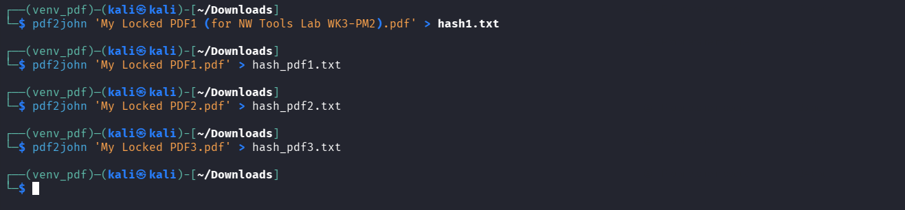
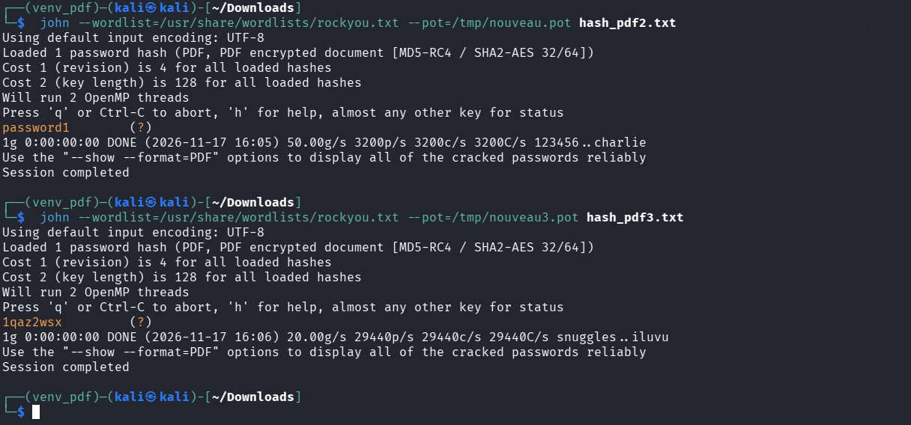
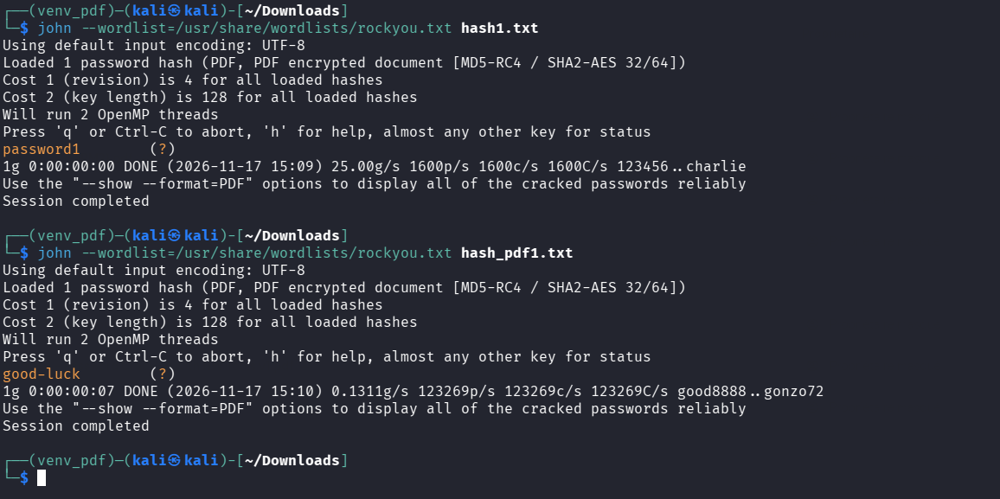
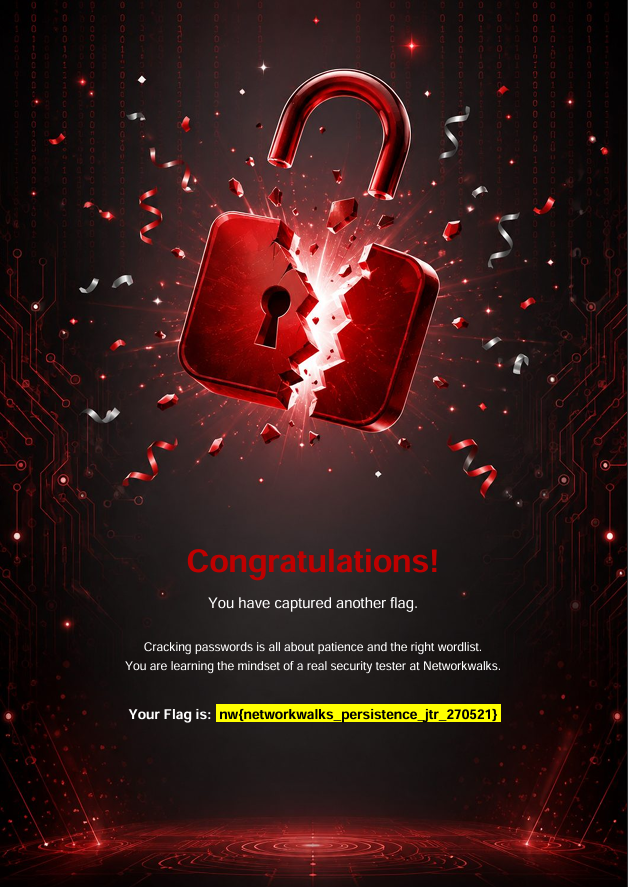

# 🔐 Networkwalks Internship – Week 3: PDF Password Cracking Lab

## 📌 Project Overview

As part of Week 3 of my Cybersecurity Internship at Networkwalks, I conducted a hands-on password security assessment involving four password-protected PDF documents.

The objective was to extract password hashes from the documents and attempt to recover their passwords using **John the Ripper** and dictionary-based attacks.

This exercise helped me understand how weak passwords can compromise the confidentiality of encrypted documents.

## 🎯 Objectives

- Extract password hashes from four protected PDF documents.
- Understand how PDF password hashing works.
- Perform dictionary attacks using John the Ripper.
- Analyze the effectiveness of common password wordlists.
- Capture the four CTF flags provided by the Networkwalks platform.

## 🛠️ Tools & Environment

| Component | Technology |
|---|---|
| Operating System | Kali Linux |
| Password Auditing | John the Ripper (Jumbo) |
| Hash Extraction | pdf2john |
| Wordlist | rockyou.txt |
| Environment | Authorized Cybersecurity Lab |

## ⚙️ Methodology

### 1. Hash Extraction

The first step consisted of extracting password hashes from the four password-protected PDF documents using `pdf2john`.

The extracted hashes were saved into individual text files for further analysis.

```bash
pdf2john "My Locked PDF1 (for NW Tools Lab WK3-PM2).pdf" > hash1.txt

pdf2john "My Locked PDF1.pdf" > hash_pdf1.txt

pdf2john "My Locked PDF2.pdf" > hash_pdf2.txt

pdf2john "My Locked PDF3.pdf" > hash_pdf3.txt
```

### 2. Dictionary Attack

After extracting the hashes, I used John the Ripper with the `rockyou.txt` wordlist to attempt password recovery.

```bash
john --wordlist=/usr/share/wordlists/rockyou.txt hash1.txt

john --wordlist=/usr/share/wordlists/rockyou.txt hash_pdf1.txt

john --wordlist=/usr/share/wordlists/rockyou.txt hash_pdf2.txt

john --wordlist=/usr/share/wordlists/rockyou.txt hash_pdf3.txt
```

To display recovered passwords:

```bash
john --show hash1.txt
john --show hash_pdf1.txt
john --show hash_pdf2.txt
john --show hash_pdf3.txt
```

### 3. Results & Analysis

All four PDF passwords were successfully recovered during the exercise.

The results demonstrated how dictionary attacks can exploit weak and predictable password choices.

**Key observations:**

- Some documents used common passwords that were present in the wordlist.
- Password reuse was identified across multiple documents.
- One recovered password was retrieved from John the Ripper's pot file.

These findings highlight the risks associated with weak password policies.

## 🚩 CTF Flags Captured

The following flags were obtained during the lab:

| Challenge | Status | Flag |
|---|---|---|
| Flag 1 | Captured | `nw{cybersecurity_flag_captured_2608}` |
| Flag 2 | Captured | `nw{networkwalks_flag_260821_1}` |
| Flag 3 | Captured | `nw{networkwalks_persistence_jr_270521}` |
| Flag 4 | Pending verification | `REPLACE_WITH_YOUR_FOURTH_FLAG` |

*Note: Replace the fourth entry with the actual flag before publishing. Do not claim four verified flags until you have confirmed all four.*

## 📸 Screenshots & Proof of Work

The following screenshots document the main stages of the exercise.

### Hash Extraction



### John the Ripper – Password Recovery





### CTF Flag Submissions





## 💡 Key Takeaways

This practical exercise reinforced several important cybersecurity concepts:

**1. Weak Passwords Are Vulnerable**

Common passwords can be recovered quickly using dictionary attacks.

**2. Password Reuse Increases Risk**

Using the same password across multiple documents means that compromising one password may expose additional protected resources.

**3. Wordlists Are Powerful**

Tools such as John the Ripper can efficiently test large collections of commonly used passwords.

**4. Security Requires Strong Password Practices**

Using long, unique passwords and password managers significantly improves protection. Additional security mechanisms, such as Multi-Factor Authentication, should also be implemented where available.

## ⚠️ Disclaimer

All activities documented in this repository were conducted within the authorized Networkwalks cybersecurity training environment for educational purposes.

This project is intended to demonstrate password security auditing techniques and promote better security practices.

---

**Networkwalks Cybersecurity Internship – Week 3**

*Learning by doing. Building practical cybersecurity skills.*
